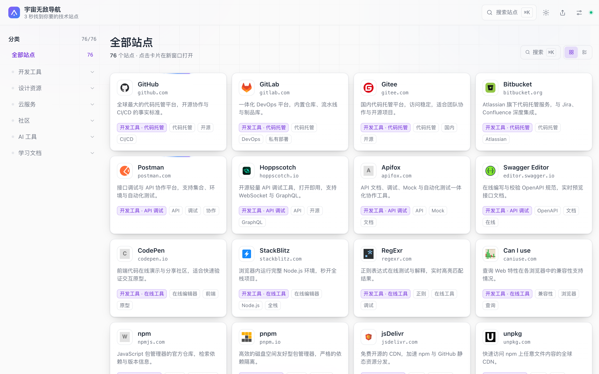
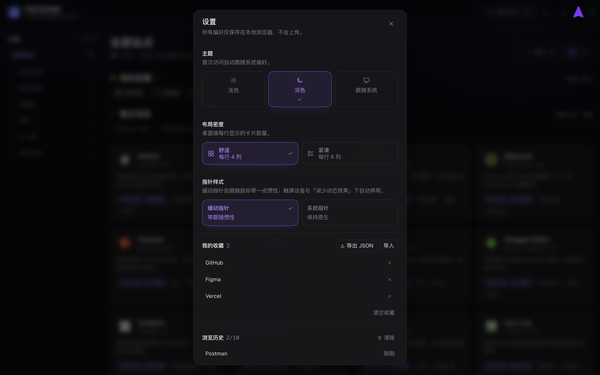
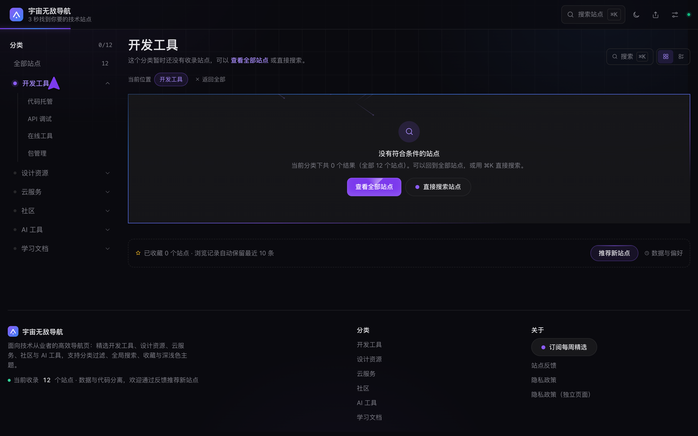

# 导航页

面向技术从业者的纯静态导航站：卡片网格、单选分类导航、全局搜索、收藏与浏览历史、主题与密度切换。构建产物是纯静态文件，可直接部署到 Vercel / Netlify / Nginx。

- 技术栈：Next.js 15（App Router，`output: 'export'`）+ React 19 + TypeScript（strict）+ Tailwind CSS 3 + Motion 14 + Magic UI（13 个装饰与交互组件）
- 数据与代码分离：`data/categories.json`、`data/sites.json`（演示数据：76 站点 / 6 一级分类 / 19 二级分类）
- 无后端：收藏、历史、主题、密度、同意状态全部存 `localStorage`

## 快速开始

仓库只保留 `pnpm-lock.yaml`（`packageManager: "pnpm@9.15.0"`）。未安装 pnpm 时执行 `corepack enable` 即可自动获取对应版本。

| 命令                          | 说明                                               |
| ----------------------------- | -------------------------------------------------- |
| `pnpm dev`                    | 开发服务器 http://127.0.0.1:4321                   |
| `pnpm build`                  | 校验数据 → 同步数据 → 静态导出到 `out/`            |
| `pnpm preview`                | 用内置静态服务器预览 `out/`                        |
| `pnpm check`                  | 数据校验 + 类型检查 + lint + 构建                  |
| `pnpm test:e2e`               | Playwright 端到端 + axe 无障碍（68 用例 / 76 次执行） |
| `pnpm test`                   | 数据校验 + 类型检查 + E2E                          |

`pnpm build` 会先跑 `scripts/validate-data.mjs`，数据格式不合法时**构建直接失败**。E2E 使用本机 Google Chrome（`channel: 'chrome'`），无需下载 Playwright 浏览器；若本机无 Chrome，执行 `pnpm exec playwright install chromium` 并把 `playwright.config.ts` 的 `channel` 改为 `'chromium'`。

## 功能

| 能力                                              | 实现要点                                                                                                                            |
| ------------------------------------------------- | ----------------------------------------------------------------------------------------------------------------------------------- |
| 卡片网格（favicon + 名称 + 描述），点击新窗口跳转 | `site-card.tsx` 整块可点击的原生 `<a target="_blank" rel="noopener noreferrer">`，无 JS 也可访问                                     |
| hover 显示完整描述与分类标签                      | 描述固定两行、卡片高度恒定；被截断时用 `ResizeObserver` 判定，在卡片外弹出完整描述浮层                                              |
| 分类导航（二级分类、当前高亮）                    | **单选导航**语义：点一级只看该分类，点二级只看该二级（非叠加筛选），标题变为「开发工具 · 代码托管」并出现面包屑                      |
| 全局搜索、输入即出下拉、键盘上下 + 回车           | `lib/search.ts` 加权打分（名称 > 标签 > 分类 > 描述）；↑/↓/Home/End + Enter + Esc；`/?q=` 深链接自动开面板并预填                    |
| 静态数据读取、骨架屏、加载失败重试                | 构建期把站点数据注入页面（禁用 JS 也能看到全部卡片与真实站点数），客户端再做一次后台校验；骨架屏只在重试时出现且尺寸对齐真实卡片；`error-state` + `retry-button` |
| 卡片星标收藏、导出 / 导入 JSON                    | `favorite-button`（`aria-pressed`）；导出文件带 `exportedAt/source/count/sites`                                                      |
| 站点反馈、分享                                    | 卡片「更多」菜单 → 反馈表单；顶栏分享复制页面或分类链接，支持 `navigator.share`，回退剪贴板 + toast                                  |
| 订阅                                              | 页脚「订阅每周精选」→ 邮箱校验 → 模拟提交成功态                                                                                     |
| 主题 light / dark / auto                          | 顶栏循环 + 设置面板三选一；持久化、首次跟随系统、`clip-path` 圆形扩散过渡、inline script 防 FOUC                                     |
| 布局密度 4 列 / 6 列                              | 设置面板与网格头部切换，`xl` 断点生效并持久化；紧凑下压缩图标/内边距/标签数                                                         |
| 指针样式 缓动 / 系统                              | 设置面板三选一之外的第二组偏好；缓动指针用 `SmoothCursor` 带跟随惯性，触屏设备与「减少动态效果」下自动回落到系统指针 |
| 浏览历史最近 10 条 + 清除                         | 首页「最近浏览」区 + 设置面板，倒序、上限 10、就地清除（二次确认）                                                                  |
| 推荐位与空态装饰                                  | Magic UI `BorderBeam` 只在 `featured` 卡片上绕边流光，`MagicCard` 让卡片描边与柔光跟随指针、`ScrollProgress` 负责顶栏阅读进度条（`useInView` 限制为可见时才动画）；空态与搜索无结果用 `Meteors` + `ShineBorder` + `BlurFade`；背景网格用 `GridPattern`；数字用 `NumberTicker` 滚动；主按钮用 `ShimmerButton`（扫光）；搜索列表裁切处用 `ProgressiveBlur`（逐层模糊）；404 的 404 字样用 `AnimatedGradientText`；「直接搜索站点」与「订阅每周精选」用 `InteractiveHoverButton`（圆点铺满）；「推荐新站点」用 `ShinyButton`（扫光）；全局指针用 `SmoothCursor`（可在设置里关闭）；装饰层一律 `pointer-events:none` / `aria-hidden` |

## 目录结构

```
app/            页面与路由（首页、6 个分类静态路由、privacy、sitemap、robots、404）
components/     UI 组件（header / category-nav / site-grid / site-card / search-command / dialogs / providers…）
components/magicui/  Magic UI 组件（border-beam / magic-card / meteors / grid-pattern / shine-border / blur-fade / number-ticker / shimmer-button / animated-gradient-text / progressive-blur / scroll-progress / smooth-cursor / shiny-button / interactive-hover-button，已改写为 Tailwind 3 语法）
lib/            纯逻辑（数据、搜索、存储、埋点、主题、剪贴板）
data/           categories.json / sites.json
public/         icons（favicon 缓存）、data（运行时数据）、og.png
scripts/        validate-data / sync-data / fetch-icons / serve-out
tests/e2e/      Playwright 用例（home / interactions / a11y / privacy-seo / responsive）
```

## 替换数据

1. 编辑 `data/categories.json` 与 `data/sites.json`，字段与约束见 [CONTRIBUTING.md](CONTRIBUTING.md#数据规范)。
2. `pnpm validate:data` 校验（id 必须 kebab-case 且唯一、分类必须存在、URL 必须 http(s)）。
3. `pnpm build` 会自动同步到 `public/data/`，并把数据在构建期注入页面（所以加站点后要重新构建）；需要本地 favicon 时执行 `node scripts/fetch-icons.mjs`。

## 测试

```bash
pnpm check              # 数据校验 → tsc → eslint → 静态构建（13 个页面）
pnpm preview            # 另开终端，http://127.0.0.1:4321
pnpm test:e2e           # Playwright + axe：桌面端 70 条 + 移动端复跑 8 条响应式 = 78 次执行
pnpm test:e2e:ui        # 可视化调试
```

| 文件                             | 条数 | 覆盖                                                                                                                         |
| -------------------------------- | ---- | ---------------------------------------------------------------------------------------------------------------------------- |
| `tests/e2e/home.spec.ts`         | 28   | 首屏网格与语义结构、重试时骨架屏、加载失败重试、二级分类单选与返回全部、`?q=` 预填、空态搜索入口、阅读进度条、切分类回顶、主题、密度、Magic UI 装饰层仅推荐位、主按钮扫光层不拦截点击、搜索裁切模糊提示、缓动指针开关与持久化、卡片描边跟随指针、进度条组件、空态流星、圆点按钮可访问名、扫光按钮开反馈 |
| `tests/e2e/interactions.spec.ts` | 16   | 搜索键盘与新窗口、⌘K/Esc 焦点归还、埋点、收藏持久化、导入导出、浏览历史、嵌套弹层、分享、订阅、反馈                            |
| `tests/e2e/a11y.spec.ts`         | 7    | axe 扫描（首页/搜索层/设置层/分类页/隐私页）、Tab 顺序、弹层内 Tab 循环、图标按钮可访问名称                                     |
| `tests/e2e/privacy-seo.spec.ts`  | 11   | 同意横幅、隐私弹窗与独立页、清除本地数据、`localStorage` 异常降级、meta/OG/JSON-LD、sitemap/robots、404                        |
| `tests/e2e/responsive.spec.ts`   | 8    | 320px 无横向溢出、移动端二级下钻、移动弹层、弹层开合不引起横向位移、同意横幅与 Toast 不重叠、1440px 密度列数                     |

## 界面

| 深色首页                                         | 浅色首页                                          |
| ------------------------------------------------ | ------------------------------------------------- |
|  |  |

| 搜索命令面板                              | 设置面板                                    |
| ----------------------------------------- | ------------------------------------------- |
|  |  |

| 二级分类单选（标题「一级 · 二级」）                | 移动端                                      |
| -------------------------------------------------- | ------------------------------------------- |
|  |  |

| 空结果页（Magic UI 流星 + 描边）            | 搜索无结果（同款描边）                              |
| ------------------------------------------- | --------------------------------------------------- |
|     |  |

| 卡片悬停（推荐位绕边流光）                  |
| ------------------------------------------- |
|  |

更多截图见 [`docs/screenshots/`](docs/screenshots)。

## 已知限制

1. **首屏 JS 约 201KB gzip**（`out/index.html` 的 script 逐文件 gzip 求和，排除 `noModule` 的 polyfills 38.6KB；含 polyfills 为 239KB）：主要来自 Next.js App Router + React 19 运行时（约 103KB）与 Motion（约 46KB）。预算上限 300KB，余量充足；如需更小体积，可换用更轻的运行时。

2. **UI 组件只用了 Magic UI，没用 shadcn/ui**：`components/magicui/` 下 14 个组件全部改写为 Tailwind 3 语法并补 `prefers-reduced-motion` 降级——`BorderBeam`（推荐位绕边流光）、`Meteors`（空态流星）、`ShineBorder`（空态与搜索无结果描边）、`GridPattern`（背景网格）、`BlurFade`（空态淡入）、`NumberTicker`（站点数滚动）、`ShimmerButton`（主按钮扫光）、`AnimatedGradientText`（404 渐变字）、`ProgressiveBlur`（搜索列表裁切提示）、`SmoothCursor`（缓动指针）、`MagicCard`（卡片描边与柔光跟随指针）、`ScrollProgress`（阅读进度条，进度值仍由顶栏自算）、`ShinyButton`（扫光按钮）、`InteractiveHoverButton`（圆点铺满按钮）。弹窗、命令面板、Toast 仍是自建：现有实现带弹层栈、滚动锁补偿与倒计时条，换成 Radix 版本需重做且体积更大（实测 +46KB gzip）。

3. **收藏拖拽排序未实现**；统计工具仅保留接口与本地缓冲，未接入真实 Umami / Plausible（`siteConfig.analytics.endpoint` 留空）。

4. **favicon 是构建前抓取的本地文件**（`public/icons/`，等价自有 CDN）：76 个图标统一压到 128px 以内、合计 387KB，运行时 `loading="lazy"` + 固定宽高 + 首字母兜底。

