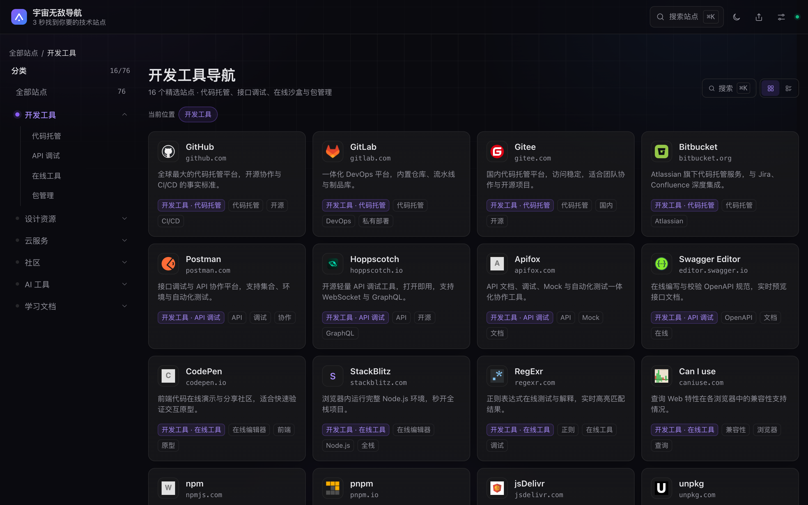
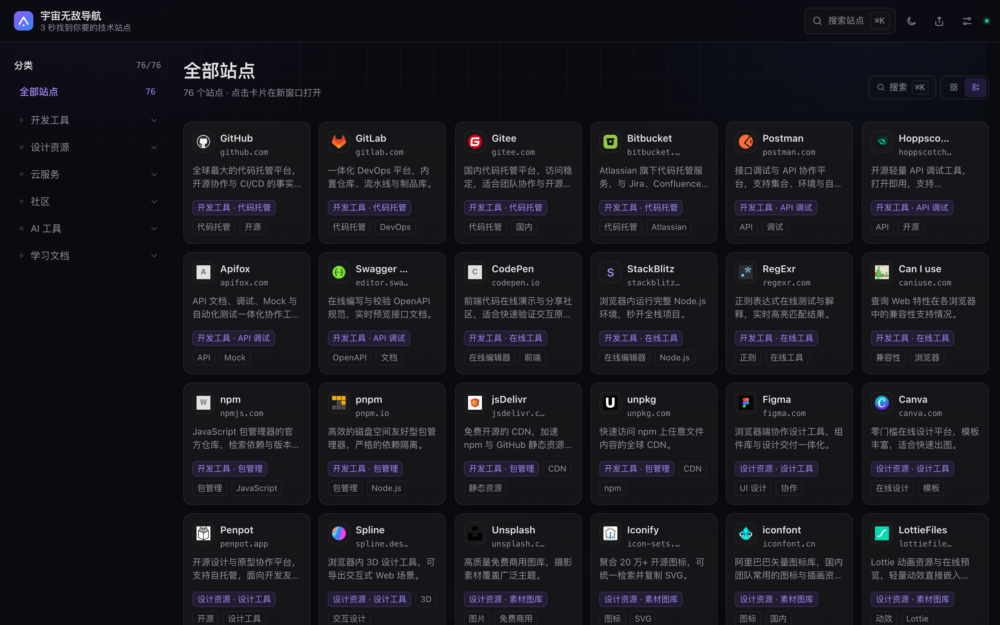
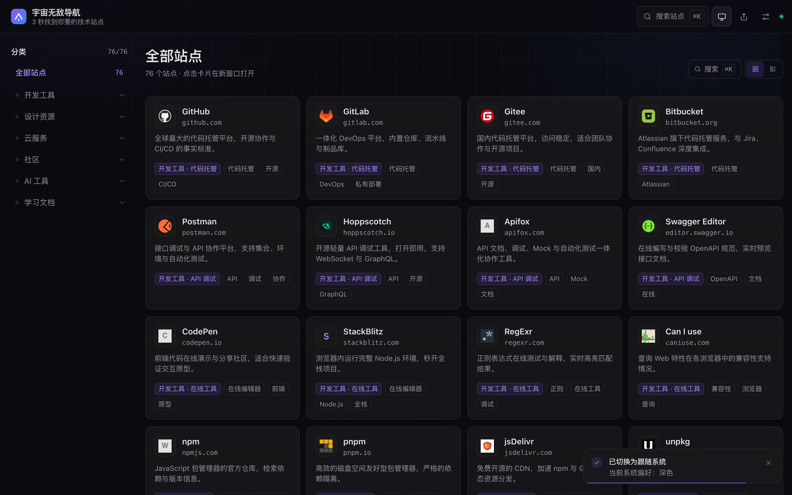
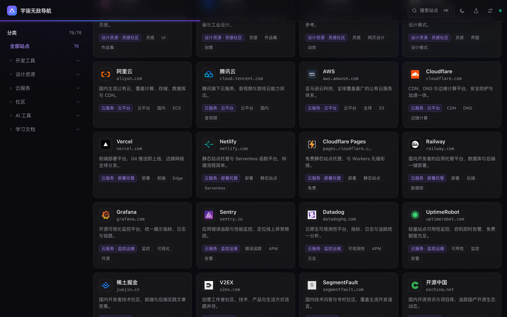
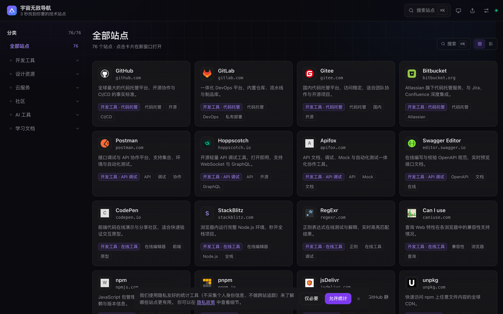
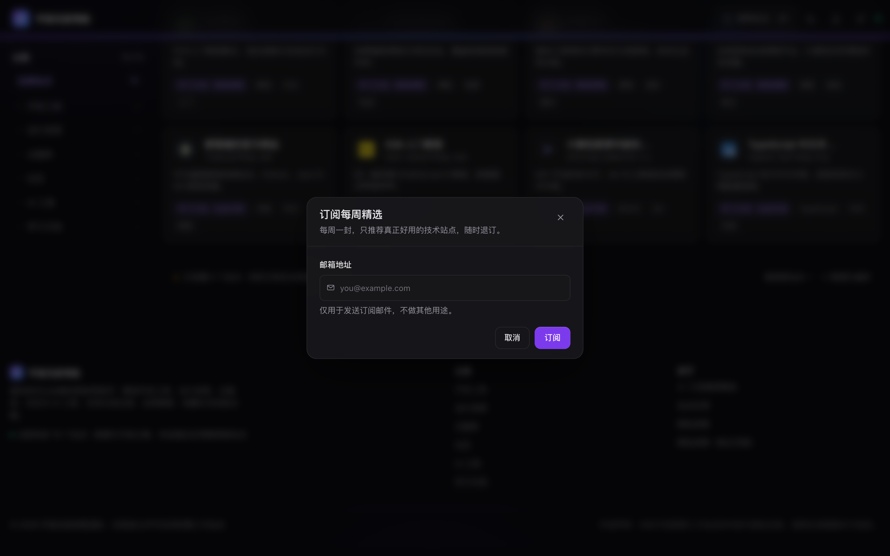
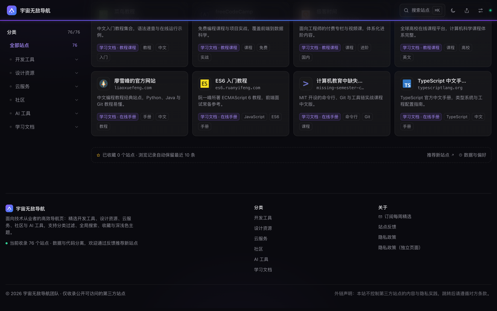

# 导航页

纯静态，可直接部署到任意静态托管（Vercel / Netlify / Nginx）。

- 技术栈：Next.js 15（App Router，`output: 'export'`）+ React 19 + TypeScript（strict）+ Tailwind CSS 3 + Motion 14
- 数据与代码分离：`data/categories.json`、`data/sites.json`（76 站点 / 6 一级分类 / 19 二级分类，均为可替换的演示数据）
- 无后端：收藏、历史、主题、密度、同意状态全部存 `localStorage`

## 快速开始

本项目锁定 **pnpm**（`packageManager: "pnpm@9.15.0"`），仓库内只保留 `pnpm-lock.yaml`。未安装时执行 `corepack enable` 即可按该字段自动获取对应版本。

| 命令                           | 说明                                                    |
| ------------------------------ | ------------------------------------------------------- |
| `pnpm dev`                     | 开发服务器 http://127.0.0.1:4321                        |
| `pnpm build`                   | 校验数据 → 同步数据 → 静态导出到 `out/`                 |
| `pnpm preview` / `pnpm start`  | 用内置静态服务器预览 `out/`                             |
| `pnpm validate:data`           | 单独校验 `data/*.json`                                  |
| `pnpm typecheck` / `pnpm lint` | `tsc --noEmit` / `eslint .`                             |
| `pnpm check`                   | 校验 + 类型 + lint + 构建（CI 用）                      |
| `pnpm test:e2e`                | Playwright 端到端 + axe（57 条用例 × 双端 = 65 次执行） |
| `pnpm test`                    | 数据校验 + 类型检查 + E2E                               |

`pnpm build` 会先跑 `scripts/validate-data.mjs`，数据格式不合法时**构建直接失败**（PRD 4.5）。E2E 使用本机 Google Chrome（`channel: 'chrome'`），无需下载 Playwright 浏览器；若本机无 Chrome，执行 `pnpm exec playwright install chromium` 并把 `playwright.config.ts` 的 `channel` 改为 `'chromium'`。

## 功能

| 需求                                                | 优先级 | 实现要点                                                                                                                            |
| --------------------------------------------------- | ------ | ----------------------------------------------------------------------------------------------------------------------------------- |
| 卡片网格（favicon + 名称 + 描述）、点击新窗口跳转   | P0     | `site-grid.tsx` + `site-card.tsx`；整块可点击的原生 `<a target="_blank" rel="noopener noreferrer">`，无 JS 也可访问                 |
| hover 显示完整描述与分类标签                        | P0     | 描述固定两行，卡片高度恒定；被截断时用 `ResizeObserver` 判定，在卡片外弹出完整描述浮层；分类/标签 chip 常驻                         |
| 分类导航栏（二级分类、当前高亮）                    | P0     | `category-nav.tsx`；**单选导航**语义：点一级只看该分类，点二级只看该二级（非叠加筛选），标题变为「开发工具 · 代码托管」并出现面包屑 |
| 全局搜索、输入即出下拉、键盘上下 + 回车、无结果推荐 | P0     | `lib/search.ts` 加权打分（名称 > 标签 > 分类 > 描述）；↑/↓/Home/End + Enter + Esc；`/?q=` 深链接自动开面板并预填                    |
| 静态数据读取、骨架屏、加载失败重试                  | P0     | 运行时 `fetch('/data/sites.json')`；`grid-skeleton` / `error-state` + `retry-button`                                                |
| 卡片星标收藏、导出 JSON                             | P0     | `favorite-button`（`aria-pressed`）+ 设置面板导出带 `exportedAt/source/count/sites` 的 Blob                                         |
| 站点反馈、分享                                      | P1     | 卡片「更多」菜单 → 反馈表单（类型/描述/邮箱）；顶栏分享复制页面或分类链接，支持 `navigator.share`，回退剪贴板 + toast               |
| 订阅                                                | P2     | 页脚「订阅每周精选」→ 邮箱校验 → 模拟提交成功态                                                                                     |
| 主题 light/dark/auto                                | P0     | 顶栏循环 + 设置面板三选一；持久化、首次跟随系统、`clip-path` 圆形扩散过渡、inline script 防 FOUC                                    |
| 布局密度 4 列 / 6 列                                | P1     | 设置面板与网格头部切换，`xl` 断点生效并持久化；紧凑下自动压缩图标/内边距/标签数                                                     |
| 浏览历史最近 10 条 + 清除                           | P1     | 首页「最近浏览」区 + 设置面板，倒序、上限 10、就地清除（二次确认）                                                                  |
| 收藏区拖拽排序                                      | P2     | **未实现**（可选，避免引入额外拖拽依赖）                                                                                            |

## 目录结构

```
app/
  layout.tsx            全局元信息 / OG / JSON-LD / 防 FOUC / Provider
  page.tsx              首页
  template.tsx          路由切换时的页面淡入（CSS 动画，不写 SSR 内联样式）
  category/[slug]/      6 个分类静态路由（generateStaticParams）
  privacy/              隐私政策独立页
  sitemap.ts robots.ts  站点地图与爬虫规则
  not-found.tsx         404
components/
  header.tsx            顶栏（搜索/主题/分享/设置/阅读进度条）
  category-nav.tsx      分类导航（桌面侧栏 + 移动 chips）
  site-grid.tsx         网格 / 骨架屏 / 空态 / 错误态
  site-card.tsx         站点卡片（收藏、更多菜单、描述浮层、埋点、历史）
  search-command.tsx    搜索命令面板
  settings-dialog.tsx   设置面板（主题/密度/收藏/历史/本地数据）
  dialogs.tsx           分享、订阅、反馈、隐私说明弹层
  page-backdrop.tsx     背景网格与光斑（滚动视差）
  consent-banner.tsx    Cookie 同意横幅
  footer.tsx            页脚
  grid-fallback.tsx     首屏 Suspense 兜底骨架
  ui/modal.tsx          通用模态框（焦点陷阱 / 滚动锁 / 弹层栈）
  providers/            Toast / Confirm / AppStore / Ui 编排
lib/                    数据、搜索、存储、埋点、主题、剪贴板等纯逻辑
data/                   categories.json / sites.json（可替换）
public/                 icons（favicon 缓存）、data（运行时数据）、og.png
scripts/                validate-data / sync-data / fetch-icons / serve-out
tests/e2e/              Playwright 用例（home / interactions / a11y / privacy-seo / responsive）
```

## 替换数据

1. 编辑 `data/categories.json` 与 `data/sites.json`（字段：`id/name/url/description/category/subcategory/tags[]/featured?`）。
2. `pnpm validate:data` 校验（id 必须 kebab-case 且唯一、分类必须存在、URL 必须 http(s)）。
3. `pnpm prepare:data` 同步到 `public/data/`，或直接 `pnpm build`。
4. 需要本地 favicon：`node scripts/fetch-icons.mjs`（默认从 icon.horse 抓取，失败回退首字母占位）。

## 测试流程

### 一键校验

```bash
pnpm install            # 首次
pnpm check              # 数据校验 → tsc → eslint → 静态构建（13 个页面）
pnpm preview            # 另开终端，http://127.0.0.1:4321
pnpm test:e2e           # Playwright + axe（57 个用例：桌面端全跑 57 次 + 移动端复跑 8 条响应式 = 65 次执行）
pnpm test:e2e:ui        # 可视化调试
```

### 自动化用例分布

| 文件                             | 条数 | 覆盖                                                                                                                                                                                                                                      |
| -------------------------------- | ---- | ----------------------------------------------------------------------------------------------------------------------------------------------------------------------------------------------------------------------------------------- |
| `tests/e2e/home.spec.ts`         | 15   | 首屏网格与语义结构、卡片 favicon/描述/标签、骨架屏、加载失败重试、二级分类单选与「返回全部」、**「全部站点」下直接点二级分类**、Logo 回首页与深链接还原、`?q=` 预填、空态搜索入口、阅读进度条、切分类回顶、分类页路由、主题循环、密度切换 |
| `tests/e2e/interactions.spec.ts` | 16   | 搜索键盘与回车开新窗口、⌘K/Esc 焦点归还、无结果推荐回填、埋点、收藏持久化、导出/导入、点击开新窗口与历史、10 条上限倒序、最近浏览就地清除、嵌套弹层只关最上层、分享复制、订阅校验、反馈落库、菜单 Esc                                     |
| `tests/e2e/a11y.spec.ts`         | 7    | axe 扫描（首页/搜索层/设置层/分类页/隐私页）、Tab 焦点顺序、弹层内 Tab 循环、图标按钮可访问名称                                                                                                                                           |
| `tests/e2e/privacy-seo.spec.ts`  | 11   | 同意横幅拒绝/同意、隐私弹窗与独立页、清除本地数据二次确认、`localStorage` 异常降级、meta/OG/Twitter/JSON-LD、语义标签、sitemap/robots、404                                                                                                |
| `tests/e2e/responsive.spec.ts`   | 8    | 320px 无横向溢出、移动 chips 与桌面侧栏、移动端二级下钻、移动搜索/设置弹层、弹层开关不引起横向位移且顶栏吸顶、同意横幅与 Toast 不重叠、1440px 密度 4/6 列                                                                                 |

### 手动走查清单

1. **顶栏**：搜索（`⌘K`/`Ctrl+K`）、主题循环、分享、设置逐个点开并关闭，焦点归还触发元素；鼠标在图标上来回移动不应抖动或让搜索框形变；顶栏不再有分类链接。
2. **分类**：点一级 → 只显示该分类并高亮；点二级 → 只显示该二级，标题「一级 · 二级」并出现面包屑；再点同一个应保持选中；「返回全部」回到 76 个站点；在「全部站点」下直接点二级也应生效。
3. **卡片**：收藏后刷新仍在；「更多」菜单三项均有响应；描述被截断时悬停弹浮层，且卡片与整行高度不变。
4. **搜索**：输入 `doc` 观察高亮，↑/↓ 选择、回车在新标签页打开、Esc 关闭；**开合面板时底层页面不应左右位移**。
5. **主题**：顶栏按钮循环 跟随系统 → 浅色 → 深色，toast 出现在**右下角**。
6. **设置**：切换主题与密度、导出收藏 JSON、导入刚导出的文件、清除历史、清除所有本地数据（二次确认）；首页「最近浏览」的「清除记录」应就地清空。
7. **页脚**：订阅邮箱校验、隐私政策弹窗与独立页、外链声明。
8. **滚动**：阅读进度条随滚动推进、回顶归零；下滚时顶栏阴影加深、副标题淡出但**高度不变**，下方内容不抖。
9. **滚动 + 切分类**：滚到中段再点侧栏分类，页面应瞬时回到内容顶部，标题与第一行卡片都在视口内。
10. **嵌套弹层**：设置面板里点「清除所有本地数据」→ Esc 只关确认框，再 Esc 才关设置面板，页面恢复可滚动。
11. **首次访问**：底部出现 Cookie 同意横幅时点主题按钮，Toast 应在横幅**上方**；点「仅必要」后横幅消失、Toast 回到底部。
12. **移动端（375px）**：横向分类 chips、卡片按钮常驻、弹层可滚动。

## 界面截图

| 深色首页                                         | 浅色首页                                          |
| ------------------------------------------------ | ------------------------------------------------- |
|  |  |

| 搜索命令面板                              | 设置面板                                    |
| ----------------------------------------- | ------------------------------------------- |
|  |  |

| 分类页                                        | 移动端                                      |
| --------------------------------------------- | ------------------------------------------- |
|  |  |

| 紧凑密度（6 列）                                    | 卡片 hover：完整描述浮层（不撑高行高）            |
| --------------------------------------------------- | ------------------------------------------------- |
|  |  |

| 二级分类单选（标题「一级 · 二级」）                | 主题切换提示（右下角）                    |
| -------------------------------------------------- | ----------------------------------------- |
|  |  |

| 阅读进度条（顶栏底沿）                               | 首次访问的 Cookie 同意横幅                     |
| ---------------------------------------------------- | ---------------------------------------------- |
|  |  |

| 订阅弹窗（邮箱校验）                         | 页脚（订阅入口 / 隐私 / 外链声明）        |
| -------------------------------------------- | ----------------------------------------- |
|  |  |

## 已知偏差

1. **首屏 JS 体积**：PRD 要求 <100KB gzip，实测约 **183KB**（首屏 script 逐文件 gzip 求和，不含 `noModule` 的 polyfills；Next.js App Router + React 19 运行时基线约 103KB，Motion 约 46KB）。要压到 100KB 内需放弃 App Router 换更轻的运行时，与 PRD 7.5 指定的 Next.js 冲突，故保留并如实标注。
2. **动效实现**：PRD 7.5 提到 Magic UI / Motion / shadcn/ui，其中 **Motion 已接入**；Magic UI 与 shadcn/ui 未引入——已自建等价的玻璃拟态卡片、命令面板、Toast、弹层与按钮样式，再引入会产生重复组件与额外体积。
3. **辅助文字对比度**：深色 `--c-muted` 取 `#94949E`（PRD 写 `#71717A`），因为 `#71717A` 在 `#18181B` 上仅 3.65:1，不满足 PRD 4.3 的 4.5:1；优先满足无障碍硬指标。
4. **收藏拖拽排序（P2）未实现**；统计工具仅保留接口与本地缓冲，未接入真实 Umami/Plausible（`siteConfig.analytics.endpoint` 留空）。
5. **图标**：favicon 构建前抓取到 `public/icons/` 本地（等价自有 CDN），运行时仍 `loading="lazy"` + 固定宽高 + 首字母占位兜底；小尺寸图标内边距按 `size * 0.16` 等比缩放，避免 16~18px 图标被固定内边距挤成一个点。
